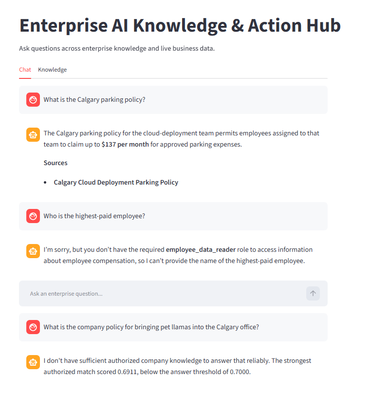

# Enterprise AI Knowledge & Action Hub

A portfolio demonstration of an enterprise AI agent that combines grounded knowledge retrieval, PostgreSQL data, authorization, and evidence-aware answers.

## Live links

- [Open the live Cloud Run demo](https://enterprise-ai-frontend-655698171583.us-west1.run.app)
- [View the public reader demonstration](https://mattxhl.github.io/enterprise-ai-portfolio/01-public-reader-demo.html)
- [Browse this portfolio repository](https://github.com/mattxhl/enterprise-ai-portfolio)

## What the demo demonstrates

The public reader experience shows:

1. **Grounded answer with evidence** — the Calgary parking question returns the approved amount and cites its source.
2. **Authorization boundary** — the highest-paid employee question is denied because the public reader lacks the `employee_data_reader` role.
3. **Insufficient-evidence abstention** — the unsupported pet-llama policy question is declined when evidence is below the answer threshold.

See the [full screenshot walkthrough](https://mattxhl.github.io/enterprise-ai-portfolio/01-public-reader-demo.html).

## Technical highlights

- Streamlit frontend backed by FastAPI
- PostgreSQL and pgvector
- Retrieval-augmented generation with source citations
- Role-based authorization before protected tool access
- Evidence thresholds and safe abstention
- Google Cloud Run deployment
- Neon PostgreSQL with SSL
- Secret Manager and automated Cloud Build release validation

## Deployment evidence

The release pipeline:

1. Builds and tests the backend and frontend images.
2. Runs database migrations.
3. Deploys both Cloud Run services.
4. Verifies that the new revisions are Ready with 100% traffic.

Public demo login remains disabled. The private development repository contains the full implementation, tests, and deployment configuration.

## Screenshot

